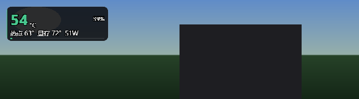

# GpuTempFloat · 显卡温度悬浮窗

常驻桌面右上角的轻量显卡温度监视器，无边框、半透明、始终置顶、不抢焦点。
悬浮窗实现参考你机器上 `yybdc/vocab_float` 的卡片方案（PySide6 + Win32 扩展窗口样式）。



## 快速开始

1. 双击 `安装依赖.bat`（首次，创建 `%LOCALAPPDATA%\GpuTempFloat\venv` 并装 PySide6）
2. 双击 `启动显卡温度悬浮窗.bat`

当前机器已装好依赖并可直接启动。

## 显示内容

```
 55°C          0%
 热点 63° 显存 72° 50W
 ▬▬▬▬▬░░░░░░░░░░
```

- 主数字为 **GPU 核心温度（EDGE）**，颜色随温度变化：<65℃ 绿 / 65–80℃ 橙 / >80℃ 红
- 第二行为热点温度、显存温度、整卡功耗
- 右上角为风扇百分比（零转停风扇时显示 rpm）
- 底部细条是 GPU 占用率

### 尺寸（右键 → 尺寸）

| 模式 | 逻辑尺寸 | 150% 缩放下实际像素 | 内容 |
| --- | --- | --- | --- |
| **迷你**（单行） | 172 × 34 | 约 301 × 60 | 一行内：温度 + 热点·显存 + 风扇，无第二行、无占用条 |
| **紧凑**（默认） | 168 × 58 | 约 294 × 102 | 温度 / 风扇 / 热点·显存·功耗 / 占用条 |
| 标准 | 212 × 100 | 约 371 × 175 | 再加上「负载 xx%」文字 |

切换后位置会自动收回屏幕内，并记住 `config.json` 里的 `size_mode`。

**文字描边**：三种模式的文字都采用「黑色描边 + 实心字」逐字符绘制（不是模糊阴影），
所以无论底下是游戏画面、白色网页还是亮色桌面，数字和标签都清晰。描边粗细随模式变化（标准 2px，其余 1px）。

### 背景透明度（滑块）

右键 → **背景与透明度** → **调节透明度（滑块）…**，卡片下方会弹出一个滑块面板：

- 范围 0–100%，**连续可调**，拖动即时生效，松开自动存盘（不再只有 100/90/80/70 四档）
- 0% 就是完全看不见底板（只剩文字和左侧色标），想要纯文字推荐直接用「无背景模式」
- 数值存在 `config.json` 的 `"opacity"`（0~1 小数）

### 无背景模式（仅文字）

右键 → **背景与透明度** → **无背景模式（仅文字）**。

开启后去掉半透明底板、边框和占用率条，只留文字（描边本来就常开），
所以在纯白、亮色或花哨的游戏画面上也不会糊掉。
适合把温度当纯 OSD 叠在游戏画面角落时使用。

配置文件里对应 `"no_bg": true / false`，重启后保留。

## 语言 / Language

中英双语，右键 → **语言 / Language** → 中文 / English，立即切换并记住（`config.json` 的 `"lang": "zh" | "en"`）。

切的是整套界面的文案，不是只换数字单位：

| 位置 | 中文 | English |
| --- | --- | --- |
| 详情行 | 热点 63° 显存 72° 51W | Hotspot 63° VRAM 72° 51W |
| 迷你行（缩写） | 热点 63° 显存 72° | Hot 63° VRAM 72° |
| 风扇（标准模式） | 风扇 39% | Fan 39% |
| 右键菜单 | 点击穿透 / 背景与透明度 / 尺寸 / 刷新间隔 / 退出 | Click-through / Background & opacity / Size / Refresh interval / Quit |
| 透明度气泡 | 背景不透明度 · 拖动即时生效，松开即保存 | Background opacity · Live preview, saved on release |
| 托盘菜单 / 悬停提示 | 隐藏悬浮窗 · 解除鼠标穿透 · 退出 | Hide overlay · Disable click-through · Quit |
| 状态气泡 | 穿透中 · Ctrl+Alt+G 解除 | Ctrl+Alt+G to release |

英文文案偏长时会自动缩小气泡字号（7–11px 自适应），不会被卡片宽度裁掉。
文本集中在 `gpu_temp_float.py` 顶部的 `I18N` 字典，加语言/改词只需往字典里加一列。

## 操作

| 操作 | 效果 |
| --- | --- |
| 左键拖动 | 移动位置（退出后记忆） |
| 右键 | 菜单：点击穿透 / 置顶 / **背景与透明度（含滑块）** / **尺寸（迷你·紧凑·标准）** / 刷新间隔 / 退出 |
| `Ctrl+Alt+G` | 开/关 **点击穿透**（游戏中不挡鼠标，最常用） |
| `Ctrl+Alt+H` | 显示/隐藏悬浮窗 |
| `Ctrl+Alt+Q` | 退出程序 |
| 双击 | 收起/展开第二行详情 |
| 托盘图标鼠标悬停 | 查看当前温度；双击切换显隐 |

### 不小心开了穿透、点不到了怎么办

穿透状态下鼠标事件全部穿过窗口，右键菜单自然也点不到。退出方式（任选其一）：

1. **按 `Ctrl+Alt+G`** —— 全局热键，不依赖窗口焦点，按一下就解除
2. **托盘图标右键 → 解除鼠标穿透**（托盘在任务栏通知区，G 图标）
3. **托盘图标右键 → 退出**，再重新启动（配置里 `click_through` 也会被重置）

穿透开启时卡片**右上角有橙色小圆点**，并把鼠标移过去时会弹出「穿透中 · Ctrl+Alt+G 解除」的提示条。

配置文件：`%LOCALAPPDATA%\GpuTempFloat\config.json`（位置、透明度、刷新间隔等）。

## 关于「盖在游戏上面」

窗口样式做了三层处理，保证它不会干扰游戏：

- `WindowStaysOnTopHint` + 每 3 秒重新置顶 → 盖在桌面、窗口化/无边框游戏之上
- `WS_EX_TOOLWINDOW` → 不进任务栏、不参与 Aero Snap 分屏（同 VocabFloat 的做法）
- `WS_EX_NOACTIVATE` → 点它不会把焦点从游戏里抢走
- 点击穿透时加 `WS_EX_TRANSPARENT` → 鼠标事件直接穿过，游戏操作不受影响

**重要限制：独占全屏（Exclusive Fullscreen）下无法覆盖。**
这不是本程序的缺陷——独占全屏时游戏直接绕过 DWM 接管显示，任何普通置顶窗口都会被盖住，
只有注入式渲染（RTSS / 驱动级 overlay）才能画上去。本机《欧洲卡车模拟2》实测即为该模式。

游戏内要看到温度，有两条路：

1. **把游戏切到「无边框/窗口化全屏」**（多数游戏都支持，本窗口即可正常浮在上面，差分极小）
2. 若只想用独占全屏，可用随 MSI Afterburner 安装的 **RTSS OSD** 在屏内显示温度
   （RTSS 是注入式，独占全屏也能画）

## 数据来源

不装任何第三方驱动、不需要管理员权限：

- **AMD**：`atiadlxx.dll` 的 `ADL2_New_QueryPMLogData_Get`（PMLog 传感器）
  - 核心温度 EDGE=8、显存 MEM=9、热点 HOTSPOT=27、风扇转速=14、风扇百分比=15、
    功耗 BOARD_POWER=73、占用=19、频率=1/2
  - 老卡若 PMLog 不可用，自动回退 `ADL2_Overdrive5_Temperature_Get`
  - 注意：ADL 的 Overdrive5 老接口在 RX 7000 系列（RDNA3）上已返回错误，必须走 PMLog
- **NVIDIA**：回退 `nvidia-smi` 查询
- 两者都不可用时窗口会显示读取失败原因，不会静默空白

`tools/adl_probe.py` 是传感器枚举自检脚本，换新显卡或驱动更新后可用它核对编号：

```
python tools\adl_probe.py
```

## 目录

```
GpuTempFloat/
├─ gpu_temp_float.py            主程序
├─ 启动显卡温度悬浮窗.bat        （源码运行）
├─ 安装依赖.bat
├─ 打包exe.bat                   一键打包成单文件 exe
├─ GpuTempFloat.spec             打包配置（剔除无用 Qt 运行时 + UPX）
├─ make_icon.py                  生成 assets\app.ico（打包用图标）
├─ assets/app.ico
├─ GpuTempFloat.exe              打包产物 24.7 MB（可脱离 Python 直接双击运行）
├─ preview.png
├─ tools/adl_probe.py            ADL 传感器枚举自检
└─ tools/upx/                    UPX 4.2.4（打包时压缩 DLL，可自动下载）
```

## 打包成 exe

双击 **`打包exe.bat`** 即可，全自动跑完 5 步：

1. 检查 Python 3.12（缺了就报错退出）
2. 建独立打包环境 `%LOCALAPPDATA%\GpuTempFloat\buildenv`（不污染运行用的 venv）
3. 装 `PySide6-Essentials==6.9.1` + `PyInstaller`（走华为云镜像）
4. 生成 `assets\app.ico`（没有才生成）；`tools\upx` 不存在时自动下载 UPX
5. 按 `GpuTempFloat.spec` 打包（onefile / windowed / 图标 / UPX），产物 `dist\GpuTempFloat.exe` 自动复制到项目根目录

**体积：24.7 MB**（最初纯 CLI 打包是 36.7 MB，减了约 33%）。缩体积的两个手段：

一是 `GpuTempFloat.spec` 里按路径关键词剔除运行时文件（`DROP_PATTERNS`）：

| 剔除项 | 省下（压缩前） | 原因 |
| --- | --- | --- |
| `opengl32sw.dll` | 20.6 MB | Qt 的软件 OpenGL 兜底，本程序不用 GL |
| `qdirect2d.dll` 等备选 QPA | 1.1 MB | 默认走 `qwindows.dll` |
| `Qt6Network.dll` + `QtNetwork.pyd` + tls 插件 | 1.5 MB | 无任何网络访问 |
| `Qt6Svg.dll` + svg 插件 | 0.8 MB | 图标全用 QPainter 画 |
| `imageformats/` 全套插件 | 1.0 MB | 不加载任何图片文件（PNG 编解码内建于 QtGui） |

二是 UPX 压缩 DLL（Qt6Core/Gui/Widgets 这些大件压得最狠），VCRUNTIME/pyside6.abi3 等少数 DLL 不压以避免启动兼容问题。

其他说明：

- `--onefile` 首次启动要解压到临时目录，约 2–4 秒才有窗口，属正常
- 打包失败时看 `build\GpuTempFloat\warn-GpuTempFloat.txt`
- **不要同时运行 exe 和源码版**：两者会抢同一组全局热键（Ctrl+Alt+G/H/Q），后启动的热键注册会失败
- 少数杀软会对 UPX 压缩过的 DLL 报可疑（误报），介意的话把 spec 里 `upx=use_upx` 改成 `upx=False` 重打即可，体积回到约 34 MB

## 想改参数

- 尺寸：右键 → 尺寸 切换，或改 `config.json` 的 `size_mode`（`compact` / `normal`）；数值在 `SIZE_MODES` 常量里
- 配色阈值：函数 `temp_color()`
- 刷新频率：右键菜单，或改 `config.json` 的 `interval`（毫秒，不建议低于 500）

## 开机自启（可选）

把 `启动显卡温度悬浮窗.bat` 的快捷方式放进
`%APPDATA%\Microsoft\Windows\Start Menu\Programs\Startup` 即可。
